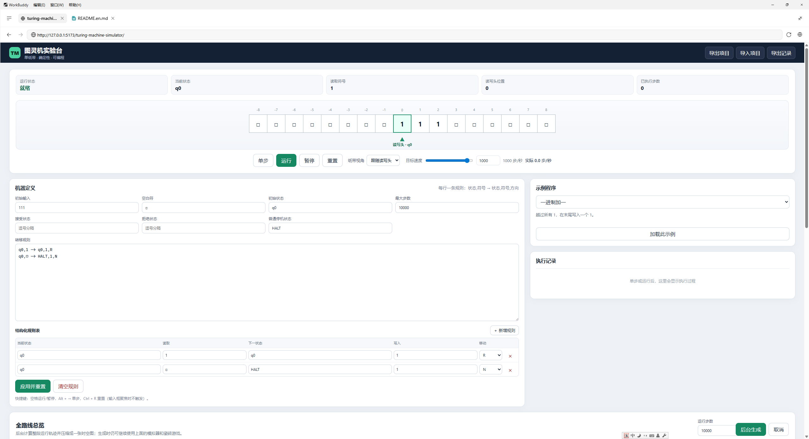
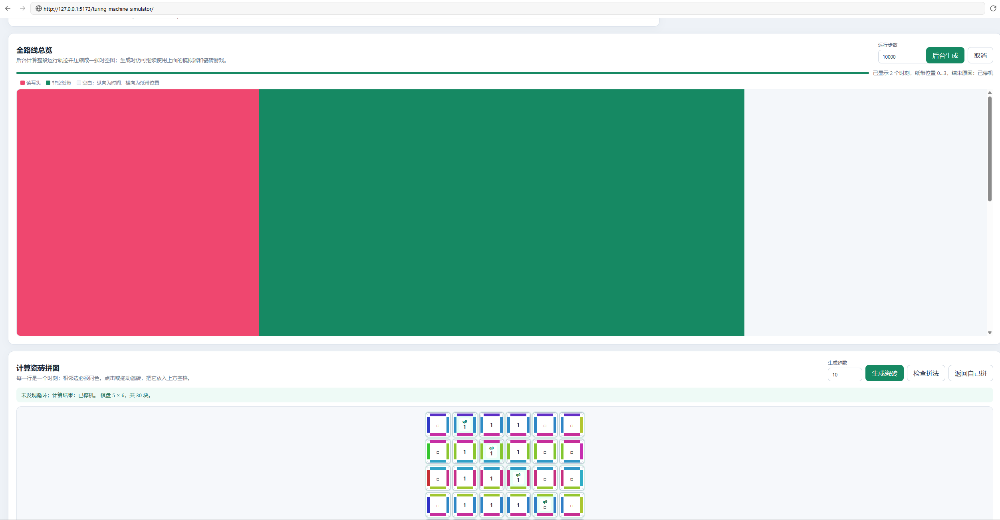

<p align="center">
  English · <a href="README.md">简体中文</a>
</p>

<p align="center">
  
  
  
  
</p>

# Turing Machine Simulator

A visual, programmable single-tape deterministic Turing machine simulator.

> This is a for-fun hobby project; issue responses are not guaranteed on any timeline. Feel free to fork and adapt it.

## Live Demo

Hosted on GitHub Pages: [https://xiaoxuhui.github.io/turing-machine-simulator/](https://xiaoxuhui.github.io/turing-machine-simulator/)

(The demo goes live after you enable GitHub Pages in the repo's **Settings → Pages** and pick the `main` branch root, or wire up a deploy workflow.)

## Features

- Sparse tape that extends left and right, with head-following view
- Step, run, pause, reset, speed up to 1000 steps/s, real speed display, and finite or Max (no fixed step limit) mode
- Plain-text and structured rule-table editing
- 23 grouped examples: function calls/returns/state exports, unary arithmetic (addition through pentation), basic programs, multi-state/multi-symbol busy beavers, and per-input Goldbach/Collatz checks
- Gijswijt's sequence: fast direct calculation or compiled, editable single-tape Turing-machine rules
- Local autosave, project JSON import/export, and execution-log CSV export
- Clear accept / reject / halt / missing-rule feedback
- Generate a Wang tile puzzle from the machine's finite computation history
- Click/drag tiling, edge-match validation, cycle detection, and one-click correct solution
- Full-route overview (default 10,000 steps, larger values allowed) compressed into a space-time diagram
- A standalone 16-level campaign split into Tutorial (10), Challenge (4), and Hard (2), with multi-input verification, sequential unlocking, and per-level drafts

## Running Modes

Target speed is saved immediately and retained across reloads and sequence conversion. Explicit project imports apply their own speed. The target remains capped at 1000 steps/s, with measured speed displayed separately.

Manual Step always uses a fixed 180ms smooth slide. Continuous runs also remain smooth at every speed, with adaptive duration and no 10-steps/s cutoff. A frame's visual offset is capped at one cell even when several transitions execute; no computation is skipped. A stationary tape viewport clips cells crossing its edges.

The workbench's **Max** checkbox disables its fixed step limit. You can still pause manually, and the machine still stops normally; a non-halting machine will keep using computing resources. This preference is saved in local and exported project data. Campaign verification and the full-route overview keep their own limits.

## Rule Functions and Drafts

Define `append(q0, exit):` followed by consistently space-indented rules. The values name its initial and exit states, not tape arguments. Call it by writing only its name on an unindented line; no `def`, call parentheses or `return` is needed:

```text
append(q0, exit):
    q0,1 -> q0,1,R
    q0,□ -> exit,1,R

append
append
```

Input `111` with ordinary halt state `HALT` takes 5 transitions and leaves `11111`. A call list continues its next call; the final call continues matching outer exit rules if present, otherwise halts. An ordinary rule calling `fn(q0,q1)` returns to outer `q1` instead of always halting; missing outer rules remain errors. Exit rules may be defined outside, not inside the function. Other terminal states still stop the program. Legacy single-state definitions retain implicit halt-based completion.

Top-level calls select their own entry and may coexist with outer rules. Without a call list, Initial State may name a function or exported state. Composite bodies contain only calls; mixing rules and calls within a body remains unsupported. Local states are isolated. Recursion is unsupported; expansion is limited to 64 levels, 10000 instances and 100000 transitions.

Extra header fields declare child functions or local aliases, e.g. `parent(q0,q1,write=child):`. A child returns to its exit-named state in the parent scope when present, otherwise to that outer state. These are function bindings, not arbitrary value arguments.

Indented `返回状态 inside` exports a local state as `parent.inside`; separate multiple states with commas. Outer rules may target or extend exports, and Initial State may select one. Extensions apply independently to repeated invocations and duplicate transitions are rejected. A public target names the default-return context, not an active temporary sequence instance. Composite functions export only entry/exit states. Two new runnable examples demonstrate outer continuation and child/export composition, producing `12` in 3 steps and `1234` in 5 steps.

Functions compile to ordinary tape rules without computation shortcuts. Their expanded table is read-only; edit source instead. Tab inserts four spaces and Enter retains indentation. Raw drafts save independently of valid projects, including unfinished syntax, exact spaces and intentional clearing. Reload restores text without Apply; execution restarts at the beginning. Explicit imports/example loads replace the draft. Storage failures show a warning. Text lost by refreshing an older version cannot be recovered automatically.

## Gijswijt's Sequence

Choose direct calculation to append one term or generate a target number of terms, with cancellation and reset. The latest 40 terms appear on a tape, and the full result is available in a text box. Switching modes retains both modes' progress for the current page session.

In Turing-machine mode, enter a threshold (0–16), convert it into rules, and use the ordinary Run or Step controls. The existing single-tape engine computes each term by comparing repeated suffix blocks. It continues on equality and writes the first term strictly above the threshold before halting. Zero means unwritten; temporary position and counting markers are cleared at halt. Threshold 2 takes 733 transitions and ends with the ninth term, 3. Threshold 3 takes 15,141,538 transitions and ends with term 220, 4—about 4.2 hours at 1000 steps/s. Direct mode is suitable for quickly inspecting longer prefixes.

Generated rules are editable, with 100 rows per table page. Conversion enables Max steps. Large rule tables may exceed browser autosave capacity; the page reports this and still supports running and JSON export. Project import accepts files up to 20 MB. Reload resets direct calculation to its seed and restarts the saved machine definition from its initial state.

## Example Programs

The selector groups 23 programs into unary arithmetic, basic examples, busy beavers, and conjecture checks. Unary inputs use the count of `1` symbols; empty operands mean zero. Examples include addition (`111+11`), subtraction (`11111-11`, negative results reject), multiplication (`111*11`), comparison (`111?11`), and divisibility by 2. All execute ordinary single-tape transition rules.

Four more arithmetic examples use `/` for floor division (`1111111/11` gives 3), `^` for exponentiation (`111^11` gives 9), `^^` for tetration (`11^^11` gives 4), and `^^^` for pentation (`11^^^11` gives 4). A finite register program is compiled into tape transitions, without precomputing the answer or adding runtime arithmetic shortcuts. Working counters lie left of the input, separated by `|`, with `#` marking the origin. At halt, only the contiguous unary answer remains. Use head-following view to see this negative-position output.

Exponent zero returns 1, including the explicit convention `0^0=1`. Tetration and pentation require a positive base; height/count zero returns 1. Towers associate rightward: `2↑↑3=2^(2^2)=16`. Pentation follows `a↑↑↑0=1`, `a↑↑↑(n+1)=a↑↑(a↑↑↑n)`; see [Knuth up-arrow notation](https://mathworld.wolfram.com/KnuthUp-ArrowNotation.html). Loading these examples enables Max but preserves target speed. Default runs take 2,865 / 9,799 / 10,624 / 18,710 tape steps respectively. `2↑↑4` and `2↑↑↑3` already require 65,536 output cells and vastly more tape operations; completion of these large inputs has not been tested. Start small and use pause or finite limits as needed.

Busy-beaver examples include 2-, 3-, and 4-state binary machines and 2-state machines with 3 or 4 symbols. The two 3-state examples distinguish the step champion (21 steps, 5 ones) from the ones champion (14 steps, 6 ones). The 2-state 4-symbol machine runs 3,932,964 steps and leaves 2050 nonblank cells; loading it enables Max. Sources and a complete input/result table are in the Chinese README.

Goldbach checks one unary-encoded even integer from 4 through 100 by testing candidate partitions with remainder scans, and leaves a prime partition such as `111+1111111` for 10. Collatz takes a positive binary integer without leading zeros (default `110`, or 6), performs the actual iterations, and accepts on reaching 1. These are checks of individual inputs, not proofs of either full conjecture. A step-limit pause is not a counterexample.

## Campaign Mode

Select **Enter Campaign** from the workbench to open a separate learning page. Tutorial levels introduce techniques in small steps, Challenge levels combine learned patterns, and Hard levels use multi-phase scans and temporary tape markers. There is no answer-loading action. Verification runs every public case in isolated temporary machines; passing them saves completion and unlocks the next level.

## The Tile Puzzle

After you apply a machine definition, a shuffled set of tiles is generated at the bottom of the page. The board reads top-to-bottom as time and left-to-right as tape position; tiles labeled with a state name mark the head. The current version generates the finite computation history (tableau) within the chosen step count and tape window, up to 30 steps, and detects cycles using the full machine configuration.

The "full-route overview" executes the current machine in a cancellable background task: red marks the head route and green marks the non-blank tape. Very long runs are compressed to at most ~2,400 sampled visualization rows; you can keep running the simulator or solving tiles while it generates, and cancel at any time.

## Screenshots


*Main UI: run status, tape, machine definition, structured rule table*


*Full-route overview (red = head, green = non-blank tape) and the computation tile puzzle*

## Run Locally

Requires Node.js 20.19 or newer and pnpm 11.

```bash
pnpm install --frozen-lockfile
pnpm dev
```

Build and test:

```bash
pnpm test
pnpm run build
pnpm run check
```

Open the local URL printed in the terminal. Everything runs entirely in your browser; machine definitions and tape contents are never uploaded.

## Project Structure

- `src/core.ts`: Turing machine and sparse-tape domain logic.
- `src/execution-scheduler.ts`: continuous-run ticking and real speed statistics.
- `src/route-controller.ts`, `src/route-worker.ts`: cancellable background full-route computation.
- `src/project-codec.ts`: project JSON v1 validation and local-storage boundary.
- `src/campaign.ts`: level definitions, multi-input verification, and sequential progress.
- `src/tile-puzzle.ts`: Wang tile puzzle from finite computation history.
- `doc/`: requirements, design, implementation plans, test reports, and phase summaries.

## Contributing and Security

Please read [CONTRIBUTING.md](CONTRIBUTING.md) before submitting code. Report security issues privately per [SECURITY.md](SECURITY.md), and follow [CODE_OF_CONDUCT.md](CODE_OF_CONDUCT.md) for community interactions. Version changes are recorded in [CHANGELOG.md](CHANGELOG.md).

## License

This project is licensed under the [MIT License](LICENSE).
