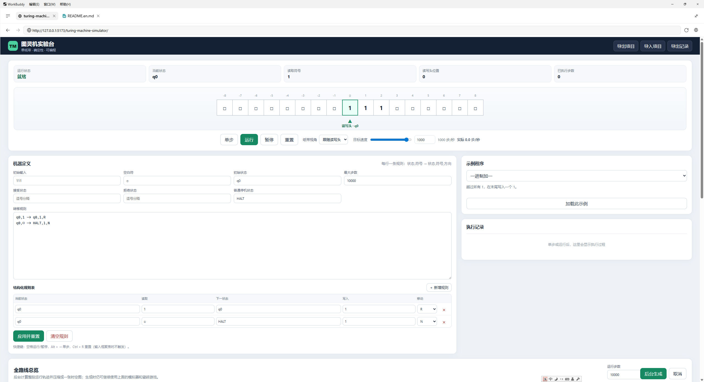
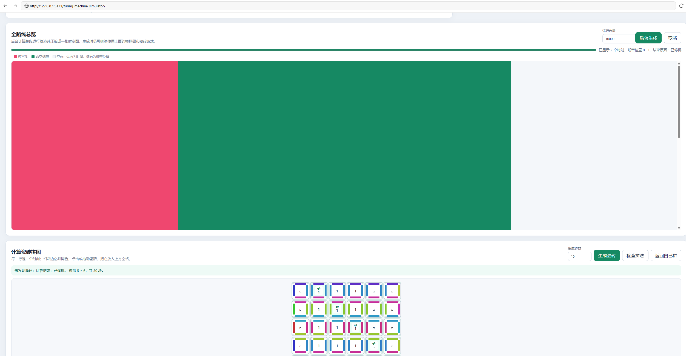

<p align="center">
  English · <a href="README.md">简体中文</a>
</p>

<p align="center">
  
  
  
  
</p>

# Turing Machine Simulator

A visual, programmable single-tape deterministic Turing machine simulator.

> This is a for-fun hobby project; issue responses are not guaranteed on any timeline. Feel free to fork and adapt it.

## Live Demo

Hosted on GitHub Pages: [https://xiaoxuhui.github.io/turing-machine-simulator/](https://xiaoxuhui.github.io/turing-machine-simulator/)

(The demo goes live after you enable GitHub Pages in the repo's **Settings → Pages** and pick the `main` branch root, or wire up a deploy workflow.)

## Features

- Sparse tape that extends left and right, with head-following view
- Step, run, pause, reset, speed up to 1000 steps/s, real speed display, and finite or Max (no fixed step limit) mode
- Plain-text and structured rule-table editing
- 44 grouped examples: 16 function tutorials in a dedicated group, unary arithmetic (the user's original register adder, addition through pentation, six floored inverses and Fibonacci generation), basic programs, multi-state/multi-symbol busy beavers, and per-input Goldbach/Collatz checks
- Gijswijt's sequence: fast direct calculation or compiled, editable single-tape Turing-machine rules
- Local autosave, project JSON import/export, and execution-log CSV export with editable filenames
- Clear accept / reject / halt / missing-rule feedback
- Generate a Wang tile puzzle from the machine's finite computation history
- Click/drag tiling, edge-match validation, cycle detection, and one-click correct solution
- Full-route overview (default 10,000 steps, larger values allowed) compressed into a space-time diagram
- A standalone 28-level campaign split into Tutorial (16), Challenge (7), and Hard (5), including functions, ret, and worked exponentiation/tetration/pentation principles; locked lessons can be previewed and old progress is retained

## Running Modes

Target speed is saved immediately and retained across reloads and sequence conversion. Explicit project imports apply their own speed. The target remains capped at 1000 steps/s, with measured speed displayed separately.

Manual Step always uses a fixed 180ms smooth slide. Continuous runs also remain smooth at every speed, with adaptive duration and no 10-steps/s cutoff. A frame's visual offset is capped at one cell even when several transitions execute; no computation is skipped. A stationary tape viewport clips cells crossing its edges.

The workbench's **Max** checkbox disables its fixed step limit. You can still pause manually, and the machine still stops normally; a non-halting machine will keep using computing resources. This preference is saved in local and exported project data. Campaign verification and the full-route overview keep their own limits.

## Rule Functions and Drafts

Define `append(q0, exit):` followed by consistently space-indented rules. The values name its initial and exit states, not tape arguments. Call it by writing only its name on an unindented line; no `def`, call parentheses or `return` is needed:

```text
append(q0, exit):
    q0,1 -> q0,1,R
    q0,□ -> exit,1,R

append
append
```

Input `111` with ordinary halt state `HALT` takes 5 transitions and leaves `11111`. Normal function completion continues below the call. Only an indented `ret q1` declaration jumps to the matching outer or caller state when q1 is reached. The Chinese spelling `返回状态 q1` remains accepted. An explicit terminal target still stops the program; a missing transition remains an error.

Initial State takes precedence: select a state, function, or public entry explicitly. An empty field defaults to the first top-level call; choosing the second function starts there, and an unknown name is never replaced with the first call. Bodies may contain rules, calls, or both. Local states are isolated. Recursion is unsupported; expansion is limited to 64 levels, 10000 instances and 100000 transitions.

Extra header fields declare child functions or local aliases, e.g. `parent(q0,q1,write=child):`. Normal child completion continues below the call; ret explicitly targets a caller/outer state. These are function bindings, not arbitrary value arguments.

Indented `导出状态 inside` exports a local state as `parent.inside`, separately from ret control flow. Outer rules may target or extend exports, and Initial State may select one. Extensions apply independently to repeated invocations and duplicate transitions are rejected. The return tutorial produces `12` in 3 steps with ret, or `19` in 3 steps after deleting ret; the combined tutorial produces `1234` in 5 steps.

Ordinary outer states retain their original compiled names: `q1` remains `q1`. Repeated independent expressions receive suffixes such as `q1_2`, avoiding existing names while preserving source order. Function-local states remain isolated per invocation, including child returns into a parent's local state.

From the first top-level bare call onward, calls and following transition expressions execute in source order. A function resumes at the expression below its call. When a top-level transition targets a function, it first searches the remaining sequence for the nearest bare call of that same function. If found, it jumps to that invocation and resumes below it; intervening expressions and other calls are skipped. If absent, it invokes the function in place and resumes below the targeting expression. Declarations before the first call use the same forward lookup. Rules for the same state with different read symbols share an entry even when written apart; repeating the same state/read pair starts a later independent expression. Each branch keeps its own source position for call lookup and continuation. Explicit ret and terminal behavior is preserved. Function bodies retain local state-graph semantics for loops and child calls.

Functions compile to ordinary tape rules without computation shortcuts. Their expanded table is read-only; edit source instead. Tab inserts four spaces and Enter retains indentation. Raw drafts save independently of valid projects, including unfinished syntax, exact spaces and intentional clearing. Reload restores text without Apply; execution restarts at the beginning. Explicit imports/example loads replace the draft. Storage failures show a warning. Text lost by refreshing an older version cannot be recovered automatically.

Use `*` in the write field to preserve the actual read symbol, and `*` in movement to stay. If only one field follows the target, R/L take priority as movement: `q0,1->target,R` moves right without writing. Other values are writes; a single N writes the character N. Use `R,*` or `L,*` to write those letters without moving. Empty write/move fields and omitted fields remain supported.

Literal star symbols use one extra star: `**` means the symbol `*`, `***` means a two-star symbol in one cell, and so on, in reads, writes and symbol parameters. Non-star-only symbols such as C* are unchanged. A read field that is empty or a single `*` matches any symbol; an empty or single-star current-state field matches any state. Keep the comma delimiters: `q0,->q1,*,*`, `,1->q1,*,*`, and `,->q1,*,*`. Match priority is exact state/exact symbol, exact state/any symbol, any state/exact symbol, then both wildcards. Function wildcard states are limited to their invocation, represented by internal-prefix.* in expanded source. Terminals stop before matching rules. Rule-table editing and copyable expanded rules preserve literal star escaping. Workbench and campaign editors highlight parse-error lines and list clickable reasons.

## Gijswijt's Sequence

Choose direct calculation to append one term or generate a target number of terms, with cancellation and reset. The latest 40 terms appear on a tape, and the full result is available in a text box. Switching modes retains both modes' progress for the current page session.

In Turing-machine mode, enter a threshold (0–16), convert it into rules, and use the ordinary Run or Step controls. The existing single-tape engine computes each term by comparing repeated suffix blocks. It continues on equality and writes the first term strictly above the threshold before halting. Zero means unwritten; temporary position and counting markers are cleared at halt. Threshold 2 takes 733 transitions and ends with the ninth term, 3. Threshold 3 takes 15,141,538 transitions and ends with term 220, 4—about 4.2 hours at 1000 steps/s. Direct mode is suitable for quickly inspecting longer prefixes.

Generated rules are editable in one continuously scrolling table, with a fixed header and no pagination. Conversion enables Max steps. Large rule tables may exceed browser autosave capacity; the page reports this and still supports running and JSON export. Project import accepts files up to 20 MB. Reload resets direct calculation to its seed and restarts the saved machine definition from its initial state.

## Example Programs

The selector groups 44 programs into unary arithmetic, function tutorials, basic examples, busy beavers, and conjecture checks. Unary inputs use the count of `1` symbols; empty operands mean zero. Examples include addition (`111+11`), subtraction (`11111-11`, negative results reject), multiplication (`111*11`), comparison (`111?11`), and divisibility by 2. All execute ordinary single-tape transition rules.

The 16 function tutorials progress from a single call through returns, exports, mixed bodies, aliases, star defaults and typed bindings. The star example writes RL in five steps; the typed binding example writes 13 in four. Lessons 13–15 cover omitted fields, compact R/L movement, literal stars and wildcard symbols/states. Lesson 16 calls SUCC twice from different places in COPY, then once from OTHER, writing 111 in five steps. Actual names place the owner first and instance number in the middle, such as COPY.FN.1.SUCC.q0, with distinct instance numbers and source call lines. Parent instances and call sites are part of the compilation cache identity. All 44 examples offer plain and commented source; plain is the default. Comments explain arithmetic phases between rules, including register increments, decrements, zero branches, parsing and cleanup for higher operations. Switching styles preserves the editor until Load is clicked. `ret` controls return flow, while `导出状态` publishes names.

Typed arguments come after the initial and exit states: `f(q0,done,move=right,function,out=finish,state,1,symbol):`. The first two fields remain unchanged. Function aliases call the bound function; state aliases jump directly to the actual outer state without an internal prefix or an extra ret. Symbols are supplied directly, including multi-character symbols such as C1. Invoke with the bare function name as before. Untyped equal bindings first look for a function, then become outer state bindings; explicit types are checked. State aliases can be sources or targets; conflicting transitions after merging into actual global states are rejected. Chinese types 函数、状态、符号 and English function/fn, state, symbol/char are supported.

An unconditional jump may omit the entire read field and its comma: `0.2->succ` equals `0.2,*->succ,*,*`. It preserves any symbol and stays in place, calling succ if it is a function or switching to the ordinary target state otherwise. This also works inside functions; lesson 13 demonstrates `q0->blank`. Use `,->target` when the source state is omitted too.

The user's original register adder is preserved in full, including `2,1->3,1,L`. With blank `0` and initial state `go`, its default `1+11` produces `111` in 146 steps. The unchanged original produces `1` for `11+`; this arithmetic discrepancy is documented in its preview for further debugging. Scan self-loops stay at their current entry when a later expression only handles another read symbol.

Mixed function bodies start at the state selected in the header. A child-function target searches later bare calls within that same body, choosing the nearest call of the same function, including aliases. If none exists, the child is invoked in place and resumes at the next expression. Bare calls resume below their own location. Ordinary local state targets still support loops, and missing read branches remain errors. Tutorial 9 uses the user's copy wrapper with a decrementing pred: input 111 becomes 11 in 6 steps, while l takes the one-step exit branch. Tutorial 10 mixes aliases, later-call lookup and in-place calls to output 123 in 6 steps.

The user-created Fibonacci generator preserves its original 54 tape transitions with descriptive state names and phase comments. It starts on an empty tape with blank `0` and Max enabled. Completed runs of `1` encode 1, 1, 2, 3, 5…; `X`/`Y` mark work in progress, so the unfinished tail is not a completed term. One million matching steps were verified against the original program.

All examples offer original/numeric state names and original/flat/shared-function structure, independently of comments. Shared-function mode extracts repeated one-entry, one-exit scanning blocks, defining each only once. A named entry `entry: sharedFunction->continuation` selects its own continuation without extra tape steps. Examples without safe duplicate blocks keep ordinary rules, and existing handwritten functions stay intact. The power example reuses five shared functions at 181 entries, removing 415 duplicate source transitions. Selecting only previews; Load applies the source. Fibonacci numeric names retain the user's original numbering, and its flat numeric source exactly matches the original 54 rules.

Six new unary examples implement floored integer inverse operations: n-th root (`n~x`), logarithm (`a@x`), super-root/super-logarithm (`~~`/`@@`), and pentation root/logarithm (`~~~`/`@@@`). They return the largest integer argument whose forward result is at most x. Root degree is positive, logarithm base is at least two, and x is positive except ordinary roots permit zero. A bounded tape computation stops each candidate once it exceeds x; no answer is precomputed. These are discrete integer threshold inverses, not fractional-height analytic extensions.

The expandable actual-name panel shows per-call name mappings, the resolved initial entry and all actual transition rules as plain text. Saved drafts migrate to compact arrows such as `q0,□->HALT,1,N` on reload, preserving indentation. Old function-lesson drafts use the same `done` completion label inside and outside when no conflicting user definition exists. The campaign adds worked arithmetic derivations and read-only previews before a level is unlocked for practice.

Editing a machine definition immediately pauses the old runtime. Unapplied compiled rules are marked as a draft preview, and existing logs are marked as records from the previous definition. Step, Run and Reset apply the current definition from its initial input and rebuild its state lookup table. Invalid drafts cannot resume the old program; undoing an edit also leaves execution paused.

Four more arithmetic examples use `/` for floor division (`1111111/11` gives 3), `^` for exponentiation (`111^11` gives 9), `^^` for tetration (`11^^11` gives 4), and `^^^` for pentation (`11^^^11` gives 4). A finite register program is compiled into tape transitions, without precomputing the answer or adding runtime arithmetic shortcuts. Working counters lie left of the input, separated by `|`, with `#` marking the origin. At halt, only the contiguous unary answer remains. Use head-following view to see this negative-position output.

Exponent zero returns 1, including the explicit convention `0^0=1`. Tetration and pentation require a positive base; height/count zero returns 1. Towers associate rightward: `2↑↑3=2^(2^2)=16`. Pentation follows `a↑↑↑0=1`, `a↑↑↑(n+1)=a↑↑(a↑↑↑n)`; see [Knuth up-arrow notation](https://mathworld.wolfram.com/KnuthUp-ArrowNotation.html). Loading these examples enables Max but preserves target speed. Default runs take 2,865 / 9,799 / 10,624 / 18,710 tape steps respectively. `2↑↑4` and `2↑↑↑3` already require 65,536 output cells and vastly more tape operations; completion of these large inputs has not been tested. Start small and use pause or finite limits as needed.

Busy-beaver examples include 2-, 3-, and 4-state binary machines and 2-state machines with 3 or 4 symbols. The two 3-state examples distinguish the step champion (21 steps, 5 ones) from the ones champion (14 steps, 6 ones). The 2-state 4-symbol machine runs 3,932,964 steps and leaves 2050 nonblank cells; loading it enables Max. Sources and a complete input/result table are in the Chinese README.

Goldbach checks one unary-encoded even integer from 4 through 100 by testing candidate partitions with remainder scans, and leaves a prime partition such as `111+1111111` for 10. Collatz takes a positive binary integer without leading zeros (default `110`, or 6), performs the actual iterations, and accepts on reaching 1. These are checks of individual inputs, not proofs of either full conjecture. A step-limit pause is not a counterexample.

## Campaign Mode

Select **Enter Campaign** from the workbench to open a separate learning page. Tutorial levels introduce techniques in small steps, Challenge levels combine learned patterns, and Hard levels use multi-phase scans and temporary tape markers. There is no answer-loading action. Verification runs every public case in isolated temporary machines; passing them saves completion and unlocks the next level.

## The Tile Puzzle

After you apply a machine definition, a shuffled set of tiles is generated at the bottom of the page. The board reads top-to-bottom as time and left-to-right as tape position; tiles labeled with a state name mark the head. The current version generates the finite computation history (tableau) within the chosen step count and tape window, up to 30 steps, and detects cycles using the full machine configuration.

The "full-route overview" executes the current machine in a cancellable background task. It divides a yellow-green-blue-yellow gradient by the distinct nonblank symbols actually present in the initial tape or written during that run. Unexecuted rules contribute no legend entries; transient writes between sampled frames still count. Red tones are reserved for the head, mixed with 30% of the current symbol color; blank cells stay pale. Longer runs that encounter new symbols rebuild the palette for the new observed set. Very long runs are compressed to at most ~2,400 sampled visualization rows; you can keep running the simulator or solving tiles while it generates, and cancel at any time.

## Screenshots


*Main UI: run status, tape, machine definition, structured rule table*


*An earlier full-route overview and computation tile puzzle; the current overview uses per-symbol colors.*

## Run Locally

Requires Node.js 20.19 or newer and pnpm 11.

```bash
pnpm install --frozen-lockfile
pnpm dev
```

Build and test:

```bash
pnpm test
pnpm run build
pnpm run check
```

Open the local URL printed in the terminal. Everything runs entirely in your browser; machine definitions and tape contents are never uploaded.

## Project Structure

- `src/core.ts`: Turing machine and sparse-tape domain logic.
- `src/execution-scheduler.ts`: continuous-run ticking and real speed statistics.
- `src/route-controller.ts`, `src/route-worker.ts`: cancellable background full-route computation.
- `src/project-codec.ts`: project JSON v1 validation and local-storage boundary.
- `src/campaign.ts`: level definitions, multi-input verification, and sequential progress.
- `src/tile-puzzle.ts`: Wang tile puzzle from finite computation history.
- `doc/`: requirements, design, implementation plans, test reports, and phase summaries.

## Contributing and Security

Please read [CONTRIBUTING.md](CONTRIBUTING.md) before submitting code. Report security issues privately per [SECURITY.md](SECURITY.md), and follow [CODE_OF_CONDUCT.md](CODE_OF_CONDUCT.md) for community interactions. Version changes are recorded in [CHANGELOG.md](CHANGELOG.md).

## License

This project is licensed under the [MIT License](LICENSE).
