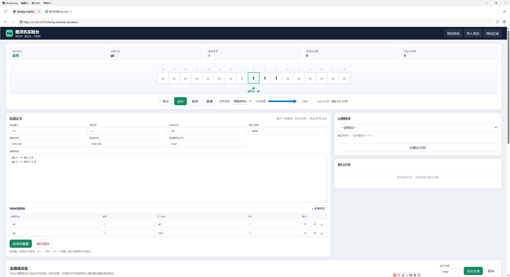
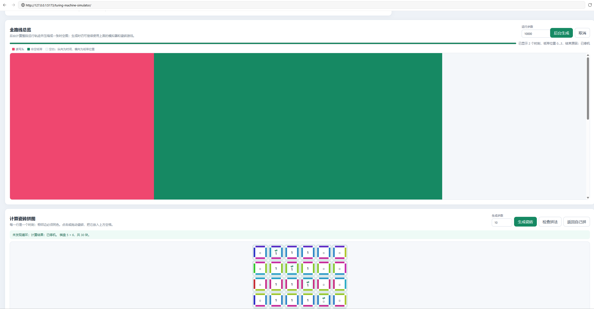

<p align="center">
  <a href="README.en.md">English</a> · 简体中文
</p>

<p align="center">
  
  
  
  
</p>

# 图灵机模拟器

一个可视化、可编程的单纸带确定性图灵机模拟器。

> 这是一个小朋友娱乐项目，issue 响应不保证时效，欢迎 fork 自行改造。

## 在线演示

部署在 GitHub Pages 上：[https://xiaoxuhui.github.io/turing-machine-simulator/](https://xiaoxuhui.github.io/turing-machine-simulator/)

（演示站点在你于仓库 **Settings → Pages** 中启用 GitHub Pages、并选择 `main` 分支的 `/（root）` 或配置部署工作流后生效。）

## 功能

- 可向左右扩展的稀疏纸带和读写头跟随
- 独立的“康威生命游戏”页面（`life.html`）：纯 B3/S23 无限平面，绘制、拖动缩放、单步、后台前进、输入输出端口、Golly RLE 与 JSON 导入导出。可读取实验台草稿，将图灵机编译成真实生命游戏逻辑门与反馈寄存器，点击“图灵机一步”推进一个完整周期。转换使用配置的有限纸带范围；越界报告“空间不足”，与停机、接受、拒绝分开。输出从实际轻型飞船信号采样，导出文件可独立在 Golly 演化；机器停机后寄存器保持结果，生命游戏本身仍可演化。大图案使用独立 IndexedDB 自动存档，保留当前代数与重置起点。门图案为 Myreen/Carneiro 的 CC BY 4.0 设计，布局与 HashLife 引擎复用逻辑工坊的 MIT 代码，详见 `src/vendor/life-notice.md`。
- 单步、连续运行、暂停、重置、最高 1000 步/秒调速、实际速度显示，以及有限步数 / Max 无固定上限模式
- 纯文本与结构化规则表双编辑方式
- 分组示例包括 16 个函数教程、一进制运算、二进制运算、基础程序，以及哥德巴赫与考拉兹的给定输入验证
- “数列生成”示例：十进制吉斯维杰特与斐波那契数列，一位一格、`|` 分隔，默认 Max 步数无限运行，可单步或暂停
- 本地自动保存、项目 JSON 导入导出、执行日志 CSV 导出；导出前可自定义文件名
- 实验台和关卡页均有“本地存档”入口：IndexedDB 自动保存历史副本，支持手动存档、查看源码、恢复、下载全部以及导入旧项目/关卡备份；切换、重置、清空或恢复前保留副本，未完成规则与已移除关卡的旧解法也可查看
- 关卡的“转到实验台”可选上次实验台内容、当前关卡示例或本关编写的规则；实验台会记住来源关卡并提供返回链接。示例区可选择“当前示例 / 上次实验台内容”，点击载入才切换，切换前自动保存输入、规则和机器配置，刷新后仍可恢复未完成代码
- 同名导出自动编号，例如 `项目.json`、`项目 (1).json`、`项目 (2).json`，项目、日志和关卡备份共用规则；本浏览器的导出记录跨刷新和标签页保留，下载目录已有文件仍由浏览器处理
- 接受、拒绝、普通停机和缺少规则的明确反馈
- 将当前图灵机的有限计算历史生成为 Wang 瓷砖拼图
- 支持点击/拖放拼砖、相邻边校验、循环节检测和一键查看正确铺法
- 全路线总览以 10,000 步为默认值，可输入更大的正整数，支持压缩总览和逐步逐格的“显示全部”
- 独立关卡页提供 79 个目标：教程 40 关、闯关 19 关、高难 20 关；教学示例及通用图灵机生成器都有对应练习。数列关卡通过观察有限步数内的正确前缀验证持续生成；忙碌海狸仅供实验台，不加入关卡和原理页
- 所有关卡统一使用单字符终态：`H` 停止、`T` 接受、`F` 拒绝；规则、参考答案、关卡示例和快捷输入保持一致。旧存档中的终态自动迁移，读取/写入符号和通用机输入中定义的目标机器名称保持原样
- 关卡中的中文函数、别名和局部状态使用 `f1`、`a1`、`s1` 等短名，类型可写 `fn/state/char`，公开状态可写 `pub`。普通关卡的方框空白改为 `_`；原有 `0`、`|` 等可直接输入的空白保留，若 `_` 已是数据则选用 `~` 等空闲字符。教程和参考答案同步更新，旧草稿自动兼容；快捷输入保留箭头，移除逗号按钮
- 独立的 `rule110.html` 页面把图灵机编译成规则 110 初始配置：展开函数/通配及 N 移动，再按 Cook 2009 §1 编译到标签系统、循环标签系统和 A–L 位图块。左右无限周期与中央有限数据用 BigInt 重复段压缩，支持导入导出、后台取消和真实规则 110 时空预览；入口在实验台顶部
- 规则 110 页面列出八种邻域更新，并显示 Golly 原生规则名 `W110`。可导出 `.mc`（全部中央数据，保留重复段压缩）或 `.rle`（当前视窗），文件自带规则名，直接在 Golly 打开；两侧加入指定保护步数的周期背景。文件注释说明坐标映射和有效演化范围；完整无限周期仍保留在 JSON 配置中
- Golly 导出默认使用 `W110:T实际宽度,0`：宽度包含两侧保护背景，左右环绕，高度无限，图案按 Golly 的边界居中放置。界面、复制按钮与文件使用同一个实际规则名；也可切回无限平面 `W110`。超出 Golly 的 20 亿格环绕宽度上限时不会截断图案
- 关卡恢复 0.8.0 历史版本的 78 关原顺序，再按连续内容划分 20 个章节；新增十进制斐波那契放在原数列关后，共 79 关。章节不决定排序，学习阶段与关键词筛选也不重排关卡
- 关卡数据、左侧列表、编号、示例顺序和“下一关”共用原始路线。提交区可直接进入相邻下一关；已保存答案、通关 ID 与原版已开放的练习保留，筛选保留当前草稿
- 关卡按任务验证普通输出、接受/拒绝、λ 归约结果、BF 输出字节、以及被模拟机器的输出和结论；验证由普通读写规则执行，在后台计算并支持取消，编辑或切换关卡会取消旧任务
- 所有关卡的完整参考程序都收录到“关卡示例”，支持有/无注释、数字状态名和函数结构；实验台试跑不会改变关卡进度
- 独立的 `principles.html` 页面集中讲解全部示例与关卡原理，可搜索、查看逐步推演，并跳转到对应示例或练习；实验台链接只选择示例，点击“加载此示例”才替换当前草稿
- 原理页按“原理、怎么实现、具体推演、主要状态与代表规则”讲解，每例最多选六个关键状态和六条代表规则；完整规则留在实验台查看
- 关卡进度与规则草稿自动保存在本机，也可下载 JSON 备份、导入恢复或确认后一键清空

## 运行模式

目标速度更改后立即保存，刷新和数列转换会保留当前选择；明确导入项目时采用项目内的速度。最高目标速度仍为 1000 步/秒，实际速度单独显示。

手动单步始终平滑移动，动画固定 180ms；连续运行也保持平滑，动画时长随速度适应，不再按 10 步/秒切换为直接移动。高速一帧执行多步时，显示最多滑动一格，计算仍执行全部转移。固定纸带窗口隐藏越界格子，避免格子与读写头飞到显示区外。

实验台的“最大步数”旁可勾选 Max。此时运行不会因固定步数暂停，仍可手动暂停或由机器正常停机；无限循环会持续占用计算资源。关闭 Max 后恢复有限步数设置。Max 选择随本地项目及 JSON 导入导出保存，不改变关卡验证或全路线总览的步数设置。

## 函数定义与调用

在“转移规则 / 函数源码”框中填写：

```text
追加(q0, 结束):
    q0,1 -> q0,1,R
    q0,□ -> 结束,1,R

追加
追加
```

括号内第一个值是初始状态，第二个是退出状态；规则使用一致的空格缩进。调用只写函数名，不写括号、`def` 或 `return`。初始输入填 `111`，普通停机状态保留 `HALT`，点击“应用并重置”和“运行”，5 步得到 `11111`。也可选择“函数：连续追加两次”示例。

初始状态框填写状态、函数名或公开状态时，从指定入口开始；填写调用序列中的第二个函数，就从该函数开始。只有留空时才默认选第一个顶格调用，未知入口不会偷偷回退。

从选定调用开始，调用和后面的表达式按源码位置继续执行。顶层表达式的下一状态是函数名时，先在后续序列中找最近的同名裸调用：有就跳到那个调用位置执行，完成后继续该位置下面，跳过中间代码；没有才就地执行函数，完成后继续当前表达式下面。首个调用之前的顶层规则也使用该查找方式。同状态、不同读取符号的规则可以分散书写，仍组成同一分支组；同一状态/符号再次出现才开始后续独立表达式。每条分支的函数搜索和续接位置仍以该条规则的源码位置为准。末尾调用没有后续代码时停机，表达式显式转到 HALT 则立即停机。

写入处用 `*` 保持实际读取的符号，移动处用 `*` 表示不移动，函数里也一样。目标后只剩一个字段时，优先认 R/L 为移动：`q0,1->目标,R` 保留 1 并右移，`q0,1->目标,L` 保留 1 并左移；其它值视为写入，`q0,1->目标,2` 写 2 不移动。要写入字符 R/L，用 `R,*` 或 `L,*` 明确两个字段；单字段 N 是写入字符 N。写入/移动留空和目标后全部省略仍有效。

字面星号用多一个星号表示：`**` 表示符号 `*`，`***` 表示由两个星号组成的一个多字符符号，以此类推，读取、写入、符号参数一致。混合符号如 C* 不转义。读取处的单个 `*` 或留空现在表示任意符号：`q0,->q1,*,*` 让 q0 遇到任何符号都原样切换到 q1。当前状态留空或单个 `*` 表示任意状态：`,1->q1,*,*`；两项都省略可写 `,->q1,*,*`，分隔逗号仍需保留。

只有状态和目标时也可直接写 `0.2->succ`，等价于 `0.2,*->succ,*,*`：无论读到什么都保持符号、不移动；succ 是函数就调用，否则切换到普通状态。函数内部同样适用，第 13 课的 `q0->blank` 演示此写法。来源状态也省略时，仍用 `,->目标` 表示两项通配。

匹配顺序为明确状态/明确符号、明确状态/任意符号、任意状态/明确符号、两者任意。函数内的任意状态限定于本次调用的局部状态，不影响其它函数和外部状态；实际展开里的 `内部名称前缀.*` 表示对应范围。终态先停机，不会再执行通配规则。规则表和可复制实际规则统一转义，重新编辑不改变字面星号。目标可为普通状态、函数或终态，支持子函数别名；未知普通目标在实际运行到它且没有匹配通配规则时报告缺少规则。

实验台与关卡编辑器实时把解析错误行标红，并列出行号及原因。点击错误跳到并选中对应行，修改正确后标记自动消失；长行改为横向滚动以保持行号定位。没有行号的全局错误只显示原因。

例如 `r`、`q1,0->q2,1,N`、`q2,1->r,1,N`、`r`：第二条表达式跳到最后一行 r，执行一次后结束。若最后一行没有 r，才在表达式处调用 r 并继续表达式下一行。函数内仍按局部状态和读取符号执行转移规则，可在函数内部编写循环和子函数调用；显式 ret 保持返回语义。

函数内部写 `ret q1` 才声明返回：执行到 q1 时跳到外面的对应状态，父函数内有该状态时则返回父函数。也兼容中文 `返回状态 q1`。不写 ret 时，括号内第二个状态只表示函数完成，不自动跳到外部同名状态。返回状态不能再定义函数内出边；函数没有走到返回状态就不会跳出。

也可以在调用处写 `函数名->完成后的状态`，不必修改被调用函数或另写转移。例如父函数的出口叫 `done`，写 `g->done` 就在 g 正常完成后直接退出父函数；写 `g->H` 就直接停机（普通停机状态须配置为 H）。目标也可以是父函数中的普通状态，或配置的接受、拒绝状态。这种调用不额外读写或移动，也不增加运行步数。父子函数的出口名称可以不同；被调用函数内部显式的 ret 跳转仍保留。`q0->g` 中 q0 不是函数名时，仍按原来的无条件转移执行。可在“函数：组合多个子函数”示例中查看。

外部状态的实际名称保留原名，例如 `q1` 转换后仍叫 `q1`。同名独立表达式重复出现时，以 `q1_2` 等后缀区分并避开已有名称，保留从上到下的执行行为。函数内局部状态继续按调用实例隔离；返回到父函数内的状态仍属于父实例。

子状态按 `父调用路径.FN.实例编号.子函数.局部状态` 命名，例如 `COPY.FN.1.SUCC.X`，父函数在前，编号居中。独立函数使用 `SUCC.FN.编号.X`。同一 COPY 内不同位置调用 SUCC 合法且编号独立；名称映射注明调用行，实际规则和运行使用相同名称。已有 `.FN.` 用户名称冲突时自动改用 `FN_` 等标记避让，用户状态原名不变。第 16 课“重复子调用与所属路径”可直接验证。

第一个顶格调用之前的规则保留为状态声明（含公开状态补写），没有调用序列时保留普通状态图行为。函数体可只包含规则、只包含函数调用，或混写两者。混合函数从头部指定的初始状态开始：目标为子函数时，在当前函数体后面找最近同名或同一绑定函数的裸调用，有则跳至该位置；没有则就地调用后继续下一表达式。裸调用完成后续行；普通局部状态仍可循环，缺少读取分支仍报缺规则。暂不支持递归。

q1 后可以列自定义子函数名，或绑定局部别名，例如 `主函数(q0,q1,写=写一):`。函数体里可以把 `写` 放在下一状态位置；普通调用完成后续行，需要指定去向时可在调用处写 `写->目标`，也可在子函数内声明 ret。旧的子函数列表仍然兼容；带类型参数还可绑定外部状态，写法如下。

前两个位置始终是初始状态和退出状态，后面可以使用“参数,类型”：

```text
组合(q0,done,移动=右移,函数,完成=finish,状态,1,符号):
    q0,1->移动,*,*
    after,□->完成,2,*
```

`移动` 绑定已定义函数 `右移`；`完成` 绑定外部状态 `finish`，到达时直接跳出，不需要额外的 ret；`1,符号` 直接使用符号 1，不用写内部符号映射。仍只写 `组合` 调用。未标类型的等号绑定先查函数，目标不是函数时作为外部状态；明确标注类型时核对函数/状态类型。符号可以是 `C1` 等多字符符号。英文类型可用 function/fn、state、symbol/char。外部状态别名也可用于规则来源；实际状态合并后有重复转移时会报错，不覆盖已有规则。选择“函数：符号、状态与函数参数”运行完整示例，输入 1，4 步输出 13；第 13～15 课分别覆盖所有省略写法、星号转义、任意符号与任意状态。

在函数体中写 `导出状态 inside`（多个用逗号分隔），即可在外部以 `主函数.inside` 作为来源、目标或初始状态。这与 ret 返回控制分开。不同函数及每次调用的内部状态独立命名；外部补写的公开规则对应每次调用，重复转移报错。直接跳入公开名使用函数默认上下文；组合函数只可导出入口和退出状态。

选择“函数：返回外部状态”：保留 ret q1 时，3 步输出 `12`；删除这一行时正常续行，3 步输出 `19`。选择“函数：子函数与返回状态”可运行完整绑定、导出与 ret 算例，空输入 5 步输出 `1234`。

“示例程序 → 函数教程”提供 16 课。所有示例都可选择“无注释 / 有注释”，默认无注释；有注释版在关键规则之间说明阶段和算法。切换选项不覆盖草稿，点击“加载此示例”才应用。“选择公开状态为入口”可在 `流程`、`流程.第二步`、`流程.第三步` 间切换，分别得到 `123`、`23`、`3`。第 9 课“条件调用与混合函数体”使用用户 copy 结构，111 经 6 步变 11，l 分支 1 步直接完成；第 10 课“混合续行与局部别名”演示后续调用搜索和就地调用，6 步输出 123；第 11 课“星号默认值与原地跳转”演示普通状态、函数调用和写入 R/L，5 步输出 RL；第 12 课“符号、状态与函数参数”说明前两项固定、参数在后，4 步输出 13；第 13～15 课分别覆盖所有省略写法、星号转义、任意符号与任意状态。


展开编辑器下方的“实际内部名称与规则”，可查看每次调用的名称映射、真实初始入口与全部实际规则。规则输出是可复制的纯文本；名称说明单独显示。普通状态跳转可以定位后面的命名规则，函数正常完成则接回调用位置下面。

教程、示例和转换规则使用紧凑箭头，例如 `q0,□->HALT,1,N`。刷新时会清理已存草稿中箭头两侧的空格，保留函数缩进和其它内容；函数题旧预置草稿中的外部 next/after 迁移为 done，已有同名定义时保留用户代码。

函数展开成普通单纸带规则，不使用计算捷径；同名局部状态互相隔离。结构化展开表只读，请在文本框修改源码；Tab 插入四个空格，Enter 保留缩进。展开上限为 64 层、10000 个实例及 100000 条规则，超限会提示。

编辑内容独立自动保存，**不必先应用**：未完成或语法错误的函数、缩进、空文本和机器配置文本均会在刷新后恢复。主动加载示例或导入项目会替换草稿。保存失败会提示刷新可能丢失，请先复制备份；刷新恢复定义和草稿，运行步数仍从起点开始。此前未保存就被旧版刷新覆盖的文字无法自动找回。

修改机器定义会立即暂停旧程序，转换区标明“草稿预览（尚未应用）”，旧日志标明“上次运行记录（旧定义）”。单步、运行和重置都会从当前定义重新开始，状态查找表随新机器重建；无效草稿不会继续跑旧程序。撤销到已应用内容也保持暂停。

## 十进制数列示例

在“示例程序 → 数列生成”中选择吉斯维杰特或斐波那契，点击载入，然后用纸带下方的运行、单步和暂停操作。两例都默认 Max 步数、不设数值停机阈值。原来的独立吉斯维杰特生成面板已移除。

两例都用十进制一位一格、`|` 分隔各项、`□` 表示空白；首个 `|` 是首项边界，`0` 是正常数字。多位数如 `10` 占两格。所有项由普通图灵机规则执行，后台显示不代算下一项。规则可在文本框或连续滚动的规则表里编辑，并支持注释、数字状态名与函数版本。

吉斯维杰特从 `|1|1|2|1|1|2|2|2|3|1…` 持续生成。O/S/A/B 隐藏标记逐格比较重复后缀，`@` 左侧的可增长工作计数器记录最大重复次数，不会在出现 3 后停机。

新的斐波那契从 `|0|1|1|2|3|5|8|13|21…` 持续生成。A/B 游标从前两项的个位向左逐列相加，进位保存在有限状态中；先写出的倒序结果由 L/R 游标原地反转，再作为下一轮的新项。原来的两个加数保持完整，数字位数随纸带增长。

忙碌海狸合集固定放在示例列表最后，单独维护在 `src/busy-beaver-records.json`，不参与关卡或原理生成。截至 2026-11-24 的来源快照收录 267 台可载入机器和 11 项仅资料记录，包含历史机器、多状态及多符号记录；去重后仍保留来源。数据依据 [Pascal Michel 历史表](https://bbchallenge.org/~pascal.michel/ha.html) 与 [bbchallenge 纪录表](https://wiki.bbchallenge.org/wiki/Champions)，并补入表中链接的完整源码。已证步数冠军、纪录下界、尚未独立核验及条件记录分别标注；没有完整规则的资料只提供来源链接。来源中的 `---` 出口转换为保持符号、原地停机，大状态 ASCII 编号转换为独立的 q 编号，避免将普通 H/Z 状态误当作停机态。所有可运行记录默认 Max，可随时暂停。

## 示例程序

在“示例程序”下拉框按类别选择，再点击“加载此示例”和“运行”。所有示例均由普通图灵机转移规则执行。一进制用 1 的个数表示数值，空操作数/空结果表示 0；输入中分隔符使用键盘上的 `+`、`-`、`*`、`/`、`^`、`^^`、`^^^`、`?`。

「二进制运算」包含加一、加法、减法、乘法、取整数商、乘方和取整对数。操作数和结果都由 `0`、`1` 组成，零写 `0`。例如 `1101/11` 得到 `100`，`11^11` 得到 `11011`，`10@1101` 得到 `11`（以 2 为底的 13 的对数向下取整）。加减逐位进借位，乘除逐位移位，乘方按指数各位平方和相乘，对数重复除以底数。

「λ 表达式归约」面板支持直接归约、单次 β 归约和图灵机纸带归约。变量名可由大小写字母、数字、下划线和点号组成，`V`、`AB_12`、`0123` 都是普通变量；应用用空格分隔，`AB` 是一个变量，`A B` 是应用。名称字符表完整包含 ABCDEFGHIJKLMNOPQRSTUVWXYZabcdefghijklmnopqrstuvwxyz_0123456789.；带点的参数写作 `λA.B . A.B`，原有 `λx.x` 写法继续支持。输入支持括号、换行和 `λ` 或反斜杠。两种模式均按最左最外 β 归约，保留原变量名；避免捕获或同名冲突时依次尝试数字后缀 `0、1、2…`，例如 `(λx.λy.x) y` 得到 `λy0.y`。Church 数仍输出完整的 λ 表达式，不转换为数字。

纸带变量名使用逐字符单元，例如 AB_12 写入五格，λ、点号及括号也各占一格；重命名的数字后缀使用独立预留格。纸带版的“初始输入”和初始纸带保留原表达式，包括空格和换行；启动只标记原字符和边界，不清空重写、不凭空添加结构括号；没有发生归约时保持原文，归约后只在分组需要时使用括号。归约时在原表达式位置替换当前子式和就近挪格，保留左侧未参与替换的部分，不再把整个表达式搬进左侧栈区。转换阶段只解析语法和生成规则，β 替换与绑定调整由普通图灵机规则执行；结果区只解码和排版纸带上的表达式。规则根据输入生成一个有限的嵌套和绑定索引范围（至少 32），超出后进入 `lambda.limit` 并明确提示尚未得到正规形，可改用直接归约。初始绑定超过 60 层时转换会提示上限。无正规形的表达式可以持续运行，直接模式可取消，纸带模式可暂停。

「BF」面板支持八条指令 `><+-.,[]`，提供循环输出 A、Hello World、输入回显、乘法和字节回绕示例。输入源码后点击“转换并载入图灵机”，再单步、运行或快速运行 BF；转换只生成规则，运算和输出都由纸带执行。单元为 8 位无符号字节，溢出回绕，左右均可延伸，输入结束读 0；文本输入输出采用 UTF-8，同时显示原始字节。空白符为 `|`，停机态为 `H`，纸带格式错误为 `R`。其它字符按 BF 习惯忽略，括号不匹配会提示源码行列。

BF 的“一进制加一”示例将输入 `111` 输出为 `1111`。单元直接使用一个字节符号，加减原位改写，不再拆成八个位搬到临时区。公共纸带生成器也合并了“取出后立即放回同一栈”的操作，减少实际往返步数。

载入“基础示例 → 通用图灵机（原文输入）”，直接在实验台上方的“初始输入”填写 `初始输入/空白符/初始状态/接受状态/拒绝状态/普通停机状态/规则第一行/规则第二行/…`，例如 `1/0/q0///HALT/q0,1->HALT,1,N`。留空的状态保留分隔斜杠，多个同类终态用 `|` 分隔；字面 `/` 写成 `\/`，字面 `\` 写成 `\\`。规则写完整的五项，函数和通配先展开，也可物理换行。点击“应用并重置”后用上方的“快速运行通用图灵机”或单步；原来的底部转换表单已移除。

输入原文直接放到纸带上，名称字典和内部编号都由图灵机逐格建立，再解释目标规则。结束后真实纸带只留下 `实际终态名称/当前结果`：例如定义的普通停机态为 `结束`，就输出 `结束/1`；接受态为 `OK` 则输出 `OK/1`。多个终态时输出实际到达的那个名称，结果为空仍保留斜杠；状态名本身的斜杠和反斜杠会转义。生成器只选择字符字母表；新增字符时应用操作会重新生成相应规则，不在 JavaScript 中执行目标机器。通用机自身使用一个不出现在输入原文中的空白符，与第二项指定的目标机器空白符不同。

有注释版的乘法按扫描、标记、复制、还原与清理分段；乘方、超幂等展开程序还会逐条说明计数器指令的增减、零值分支、输入解析和最终清理。无注释版去除这些说明，执行规则保持一致。

所有示例都可选择“示例原名/数字状态名”以及“保留示例结构/无函数（展开规则）/公共函数（提取重复代码）”，注释风格独立选择。公共函数版把相同的单入口、单出口扫描块定义一次，各入口用 `入口状态: 公共函数->续接状态` 分别接回后续，不增加计算步；无安全重复块则保留原规则，已有手写函数保持原结构。乘方示例提取5个公共函数供181个入口复用，减少415条重复源码规则。选择只预览，点击“加载此示例”才应用，刷新保留源码。


新增六种向下取整的整数逆运算：`n~x` 求n次方根，`a@x` 求对数，`n~~x`/`a@@x` 求超根号/超对数，`n~~~x`/`a@@@x` 求超超根号/超超对数。根号返回使正向运算≤x的最大整数底数，对数返回最大整数指数/高度/次数；高阶根号要求n≥1、x≥1，对数要求a≥2、x≥1，普通根号允许x=0。输入仍用1的数量表示，例 `11~11111` 的答案为 `11`。候选试算超过x就提前停止，数值由纸带规则实际计算；仅处理整数阈值逆运算，不涉及非整数幂塔延拓。

| 示例 | 初始输入 | 结果或停机行为 |
| --- | --- | --- |
| 函数：定义与单次调用 | 空 | 1 步输出 `1` |
| 函数：连续追加两次 | `111` | 自动续接两次调用，5 步得到 `11111` |
| 函数：返回外部状态 | 空 | 函数退出后继续外部 q1，3 步输出 `12` |
| 函数：组合多个子函数 | 空 | 多个原名/别名绑定，顺序调用，3 步输出 `123` |
| 函数：子函数返回父状态 | 空 | 子函数返回父作用域的同名状态，4 步输出 `123` |
| 函数：选择公开状态为入口 | 空 | 默认从第二步启动，2 步输出 `23`，可切换入口 |
| 函数：公开规则与重复调用 | 空 | 外部补写的规则匹配两次独立调用，4 步输出 `1212` |
| 函数：子函数与返回状态 | 空 | 子函数返回父状态、导出局部状态后继续外部 q1，5 步输出 `1234` |
| 函数：条件调用与混合函数体 | `111` | 空白 0，按 copy 的读取分支执行 pred，6 步得到 `11`；输入 l 时 1 步保留 l |
| 函数：混合续行与局部别名 | 空 | 规则与裸调用混写，6 步输出 `123` |
| 函数：星号默认值与原地跳转 | `1` | `*,*` 切换状态或调用函数，写入 R/L，5 步输出 `RL`，头停在位置 1 |
| 函数：符号、状态与函数参数 | `1` | 前两项入口/退出，后续参数标类型；函数调用后跳到外部 finish，4 步输出 `13` |
| 函数：省略字段与 R/L 简写 | `1` | 全省略、独立留空、单字段移动、字母 R/L 写入，8 步输出 `2L` |
| 函数：星号字符的转义 | 空 | 5 步；位置 0 含 `*`，位置 1 含多字符符号 `**` |
| 函数：任意符号与任意状态 | `A` | 4 步输出 `A*`；改输入 Z 时 2 步保留 Z |
| 函数：重复子调用与所属路径 | 空 | COPY 在不同位置调用两次 SUCC，OTHER 再调一次，5 步输出 `111`；名称明确显示所属路径及独立实例 |
| 一进制加一 | `111` | `1111` |
| 一进制加法 | `111+11` | `11111` |
| 一进制减法 | `11111-11` | `111`；负结果 REJECT，相等时纸带为空 |
| 一进制乘法 | `111*11` | `111111`，结果在原输入右侧，操作数清除 |
| 一进制除法（取商） | `1111111/11` | `111`，即 7÷2 取整商 3；除数 0 拒绝 |
| 一进制乘方 | `111^11` | 9 个 1，即 3² |
| 一进制超幂（幂塔） | `11^^11` | 4 个 1，即 2↑↑2；`11^^111` 得 16 个 1 |
| 一进制超超幂 | `11^^^11` | 4 个 1，即 2↑↑↑2 |
| 一进制大小比较 | `111?11` | `>`（也可输出 `<`、`=`） |
| 一进制整除 2 判断 | `1111` | 偶数 ACCEPT，奇数 REJECT，0 接受 |
| 二进制加一 | `1011` | `1100` |
| 二进制回文判断 | `1001` | ACCEPT |
| 哥德巴赫给定偶数验证 | `1111111111`（10） | ACCEPT，输出 `111+1111111`，即 3+7 |
| 考拉兹给定起点验证 | `110`（二进制 6） | 反复运算至 `1` 后 ACCEPT |

除法至超超幂的规则来自有限寄存器程序的展开：把增一、减一和零分支编译为普通单纸带转移，**编译时不预先计算答案**，运行核心没有新增算术捷径。`#` 是原点标记、`|` 分隔计数器；工作区及最终答案位于原输入左侧，停机清除全部辅助符号，只留下连续的 `1`。使用“跟随读写头”可看到答案；固定在 0 的视角可能看不到左侧结果。

乘方允许底数 0，指数 0 返回 1，本示例约定 `0^0=1`（输入 `^`）。超幂和超超幂只接受正整数底数，高度/次数 0 返回 1（例如 `11^^`、`11^^^`）。幂塔右结合：`2↑↑3=2^(2^2)=16`；超超幂递推为 `a↑↑↑0=1`、`a↑↑↑(n+1)=a↑↑(a↑↑↑n)`。符号约定参考 [Knuth 上箭头记号](https://mathworld.wolfram.com/KnuthUp-ArrowNotation.html)。

这四例加载时自动开启 Max，但不改目标速度。默认输入分别需要 2,865、9,799、10,624、18,710 步，在实际接近 1000 步/秒时约为 3、10、11、19 秒。`2↑↑4` 与 `2↑↑↑3` 的答案已有 65,536 个 `1`，单纸带搬运的实际运行步数远大于输出长度；未对这些大输入做完成验收。请从默认小数开始，必要时暂停、重置或关闭 Max 设置上限。


哥德巴赫示例仅验证一个 4–100 的偶数，运行时试除并搜索素数分拆；奇数、范围外输入拒绝。考拉兹输入无前导 0 的正整数二进制；0、空输入及前导 0 拒绝，偶数除 2，奇数乘 3 加 1。它们验证的是给定输入，不是整个猜想；达到步数上限只表示暂停，不能当作反例。

## 关卡模式

点击实验台顶部“进入关卡”会打开独立教学页。课程分为教程、闯关、高难三段：教程用小步过渡讲解基础套路，闯关要求组合已学知识，高难引入多阶段扫描和临时标记。每关提供原理、策略、专用规则编辑器和示例试跑。页面不提供答案载入；提交时会在临时机器中运行全部公开测试，通过后保存完成状态并解锁下一关。

页面顶部的“保存备份”会下载包含通关记录与已保存规则草稿的 JSON 文件；“导入备份”经确认后替换本机当前关卡存档。“一键清空”也需确认，只清除关卡进度和草稿，不影响实验台或已下载文件。旧版本存档若没有保存某关规则，备份无法反推该关的通关写法。

## 计算瓷砖拼图

应用机器定义后，页面底部会自动生成一组打乱的瓷砖。棋盘从上到下表示时间，从左到右表示纸带位置；带状态名的瓷砖表示读写头。当前版本生成的是所选步数和纸带视窗内的有限计算历史（tableau），最大 30 步，并用完整机器配置检测循环。

“全路线总览”会在独立后台任务中执行当前机器。仅统计本次初始纸带和实际执行中出现的不同非空符号，按数量等分黄→绿→蓝→黄渐变并显示图例；未执行规则中的运算符不占颜色。采样间短暂写入又擦除的符号也保留。红色系只给读写头，混入 30% 当前符号色，空白仍为浅色。增加步数若首次遇到新符号，会按新的实际数量重新分配颜色。“压缩总览”最多显示约 2400 条可视采样行；“显示全部”保存每一步的状态、头位置和纸带变化，逐步逐格绘制，可横向、纵向滚动以及定位步数，悬停查看具体符号。大轨迹只绘制当前可见区域。若先生成了压缩总览，切到显示全部时会按同一份机器和输入重新后台生成；完整生成后可直接切换两种视图。生成期间仍可继续运行模拟器或拼瓷砖，并可随时取消。

## 截图


*主界面：运行状态、纸带、机器定义、结构化规则表*


*早期版本的全路线总览与计算瓷砖拼图；当前路线预览已按符号分色。*

## 本地运行

需要 Node.js 20.19 或更高版本，以及 pnpm 11。

```bash
pnpm install --frozen-lockfile
pnpm dev
```

构建与测试：

```bash
pnpm test
pnpm run build
pnpm run check
```

浏览器打开终端显示的本地地址即可使用。项目完全在浏览器本地运行，不会上传机器定义或纸带内容。

需要关闭终端后继续使用本地服务时，运行 `node scripts/start-dev-server.mjs`（或 `pnpm dev:background`）。独立后台进程固定监听 `http://127.0.0.1:5173/turing-machine-simulator/`；重复运行会复用已启动的服务。日志和 PID 位于 `.vite/dev-service/`。电脑关机或退出登录后需要重新启动。

## 项目结构

- `src/core.ts`：图灵机和稀疏纸带领域逻辑。
- `src/execution-scheduler.ts`：连续运行时间片与实际速度统计。
- `src/route-controller.ts`、`src/route-worker.ts`：可取消的后台全路线计算。
- `src/project-codec.ts`：项目 JSON v1 校验和本地存储边界。
- `src/campaign.ts`：关卡定义、多输入验证和顺序解锁进度。
- `src/campaign-backup.ts`：关卡 JSON 备份的编码与严格校验。
- `src/tile-puzzle.ts`：有限计算历史的 Wang 瓷砖拼图。
- `doc/`：需求、设计、实施计划、测试报告和阶段总结。

## 参与贡献与安全

提交代码前请阅读 [CONTRIBUTING.md](CONTRIBUTING.md)，安全问题请按 [SECURITY.md](SECURITY.md) 私密报告，社区互动遵循 [CODE_OF_CONDUCT.md](CODE_OF_CONDUCT.md)。版本变化记录在 [CHANGELOG.md](CHANGELOG.md)。

## 许可证

本项目采用 [MIT License](LICENSE)。

纸带视角中的“显示全部”会列出所有已写入内容和当前读写头，自动换行并随运行更新；很长的未写入空白区折叠为范围提示。λ 纸带仍可切换是否显示辅助格。
